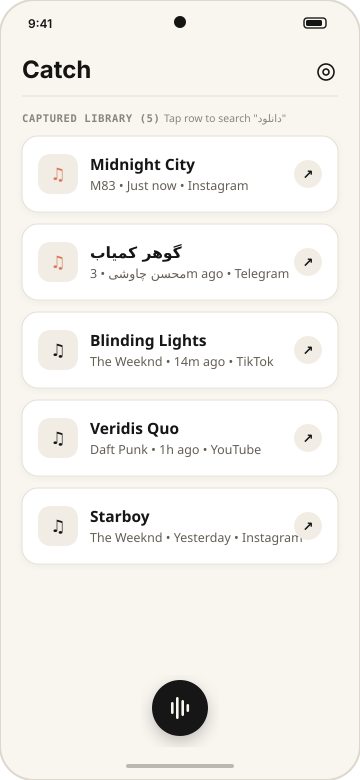
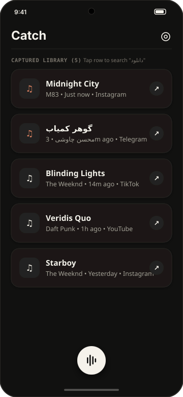
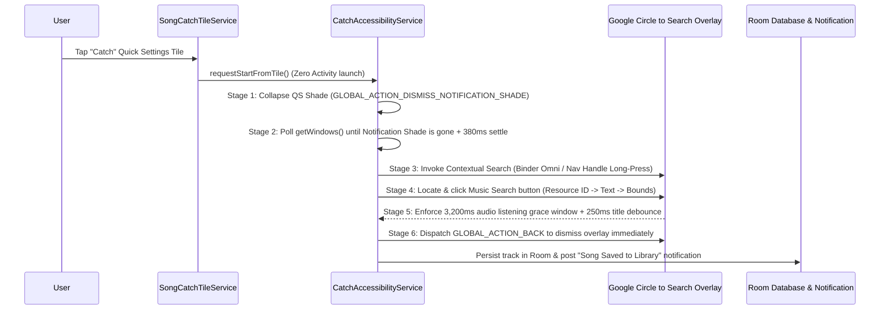

# Catch

[](https://github.com/ahmadZMVD/Catch/actions/workflows/ci.yml)
[](https://github.com/ahmadZMVD/Catch/releases/latest)
[-141413)](https://developer.android.com)
[](https://kotlinlang.org)
[](LICENSE)

<p align="center">
  
  &nbsp;&nbsp;&nbsp;&nbsp;
  
</p>

**Catch** is a zero-pause Android song recognition utility that bridges a Quick Settings Tile directly to Google's system-level **Circle to Search** / **Sound Search** internal audio engine, automatically saves recognized tracks to a local Room database, and enables 1-tap Persian music download queries (`"<Song> <Artist> دانلود"`).

---

## Why Catch Exists

Identifying background music playing inside short-form video apps (Instagram Reels, Telegram video channels, TikTok, YouTube Shorts) typically breaks media playback:
1. Switching to an external recognition app pauses the foreground video player.
2. Microphone-based recognition degrades in noisy environments or when listening over Bluetooth headphones.
3. Manually invoking Circle to Search, tapping the Music note button, copying the recognized title, and pasting it into a browser takes 5–6 manual interactions per track.

**Catch** reduces this workflow to a single tap on the **Catch** Quick Settings Tile while keeping the underlying video playing uninterrupted.

---

## Architecture & Recognition Pipeline

```text
app/src/main/java/com/example/
|-- CatchApplication.kt                      # Application graph wiring Room, DataStore, and state listeners
|-- MainActivity.kt                          # Edge-to-edge Compose host activity
|-- data/
|   |-- local/
|   |   |-- AppDatabase.kt                   # Room SQLite database with WAL concurrency
|   |   |-- CapturedSongDao.kt               # Reactive Flow queries, search filtering, and deduplication
|   |   `-- CapturedSongEntity.kt            # Normalized track entity (title, artist, source package, timestamp)
|   |-- preferences/
|   |   `-- UserPreferencesRepository.kt     # Jetpack DataStore for theme mode and capture settings
|   `-- repository/
|       `-- SongRepository.kt                # Repository layer + JSON / CSV / Markdown export & restore
|-- domain/
|   `-- interception/
|       |-- GoogleMusicNodeParser.kt         # Multi-locale AccessibilityNodeInfo parser & geometric heuristics
|       |-- InterceptionModels.kt            # Immutable state snapshots & window layer summaries
|       `-- InterceptionStateMachine.kt      # Deterministic state machine with 250ms result stabilization
|-- notification/
|   |-- NotificationActionReceiver.kt        # BroadcastReceiver for 1-tap notification download search
|   `-- SongNotificationDispatcher.kt        # Heads-up confirmation notification builder
|-- service/
|   |-- CircleToSearchInternalAudioEngine.kt # 6-stage non-pausing recognition orchestrator
|   |-- GoogleMusicAccessibilityService.kt   # Event-gated AccessibilityService bridge
|   |-- HiddenApiHelper.kt                   # Multi-API VoiceInteraction binder invoker (API 28-36)
|   |-- SongCatchTileService.kt              # Quick Settings TileService entry point
|   `-- TileTriggerTrampolineActivity.kt     # Transparent fallback trampoline when Accessibility is inactive
|-- ui/
|   |-- CatchViewModel.kt                    # Unidirectional StateFlow ViewModel
|   |-- SettingsBottomSheet.kt               # Theme switcher, JSON/CSV backup, and diagnostics sheet
|   |-- SongHistoryScreen.kt                 # Warm Bone / Obsidian library UI & 56.dp circular Catch button
|   |-- components/                          # Restricted Settings 2A->2B->2C wizard, legacy detector, and sheets
|   `-- theme/                               # Color tokens, typography, and Material 3 theme
`-- util/
    |-- PersianDownloadBrowserLauncher.kt    # UTF-8 URL encoder appending Persian download suffix
    |-- PlatformCompat.kt                    # Central SDK-version compatibility dispatcher (API 28-36)
    |-- RestrictedSettingsSessionUnlocker.kt # PackageInstaller PACKAGE_SOURCE_STORE session unlocker
    `-- SystemPermissionHelper.kt            # Accessibility, notification, and 2A->2B->2C setup helpers
```

### Six-Stage Non-Pausing Pipeline



---

## Multi-API & Multi-Architecture Compatibility

| Android Version | API Level | Shade Collapse Mechanism | Contextual Search Invocation |
| :--- | :--- | :--- | :--- |
| **Android 14 – 16** | API 34 – 36 | `GLOBAL_ACTION_DISMISS_NOTIFICATION_SHADE` (`15`) | 4-arg `showSessionFromSession` -> Nav Handle Long-Press (`950ms`) |
| **Android 12 – 13** | API 31 – 33 | `GLOBAL_ACTION_DISMISS_NOTIFICATION_SHADE` (`15`) | 3-arg `showSessionFromSession` -> Nav Handle Long-Press (`950ms`) |
| **Android 9 – 11** | API 28 – 30 | `Intent.ACTION_CLOSE_SYSTEM_DIALOGS` | 3-arg `showSessionFromSession` -> `com.google.android.googlequicksearchbox.MUSIC_SEARCH` |

### Download APK by Device Architecture

| APK Variant | Target CPU Architecture | Recommended Devices | Download |
| :--- | :--- | :--- | :--- |
| **`Catch-v1.0.1-arm64-v8a.apk`** | 64-bit ARM (`arm64-v8a`) | All modern phones & tablets (2018–present) | [Latest Release](https://github.com/ahmadZMVD/Catch/releases/latest) |
| **`Catch-v1.0.1-armeabi-v7a.apk`** | 32-bit ARM (`armeabi-v7a`) | Legacy 32-bit ARM devices & Android Go | [Latest Release](https://github.com/ahmadZMVD/Catch/releases/latest) |
| **`Catch-v1.0.1-x86_64.apk`** | 64-bit x86 (`x86_64`) | ChromeOS, Android Studio Emulators, PC/WSA | [Latest Release](https://github.com/ahmadZMVD/Catch/releases/latest) |
| **`Catch-v1.0.1-x86.apk`** | 32-bit x86 (`x86`) | Legacy x86 tablets & emulators | [Latest Release](https://github.com/ahmadZMVD/Catch/releases/latest) |
| **`Catch-v1.0.1-universal.apk`** | All ABIs (`universal`) | Universal installer supporting every architecture | [Latest Release](https://github.com/ahmadZMVD/Catch/releases/latest) |

---

## Setup Guide (Android 9 – 16)

1. **Add the Quick Settings Tile**: Open **Catch** and tap **Add Tile** in the setup card (or pull down your Quick Settings panel, tap the Edit pencil icon, and drag **Catch** into your active tiles).
2. **Unlock Restricted Settings on Android 13+ (if sideloaded)**:
   - **Step 2A**: Tap **1. Open Accessibility List**, tap **Catch**, and when Android shows the *"App was denied access"* dialog, tap **Close** (this unlocks the 3-dot menu in App Info).
   - **Step 2B**: Return to Catch, tap **2. Open App Info**, tap the **3-dot menu (`⋮`)** in the top-right corner, and tap **Allow restricted settings** (on Xiaomi HyperOS, scroll to the bottom of App Info and enable *Allow restricted settings*; on Samsung One UI, ensure *Settings -> Security and privacy -> Auto Blocker* is off if restricted settings remains grayed out).
   - **Step 2C**: Tap **3. Enable Catch in Accessibility** and switch **Catch** to **ON**.
3. **Unrestricted Background Battery**: Tap **Unrestrict** in Step 4 of the setup card so your device OEM power manager does not suspend the Quick Settings tile or Accessibility service in the background.

---

## Building from Source

### Prerequisites
- JDK 21 (Temurin recommended)
- Android SDK Platform 36 (`compileSdk 36`, `minSdk 28`)

### Build Commands

```bash
# Run unit, fuzz, and Robolectric architectural tests
./gradlew testDebugUnitTest

# Assemble all ABI-split + universal Release APKs and generate SHA256SUMS.txt
./gradlew assembleRelease collectReleaseApks
```

Compiled APKs are written to `app/build/outputs/apk/release/` and staged in `dist/`.

---

## Privacy & Security

- **Zero Network Permissions**: Catch does **not** request `android.permission.INTERNET`. It never uploads audio, screen contents, or analytics to any server.
- **Event-Gated Inspection**: The Accessibility service only inspects `com.google.android.googlequicksearchbox` nodes during an active user-initiated song recognition window (hard-capped at `18s` by a watchdog timer) and remains completely idle at all other times.

---

## License

Released under the [MIT License](LICENSE).
